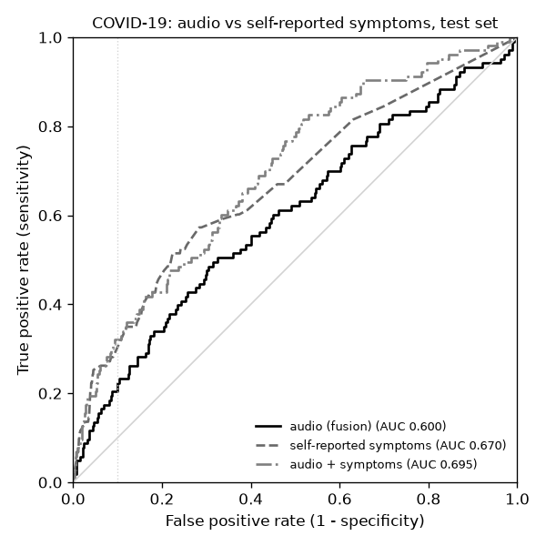
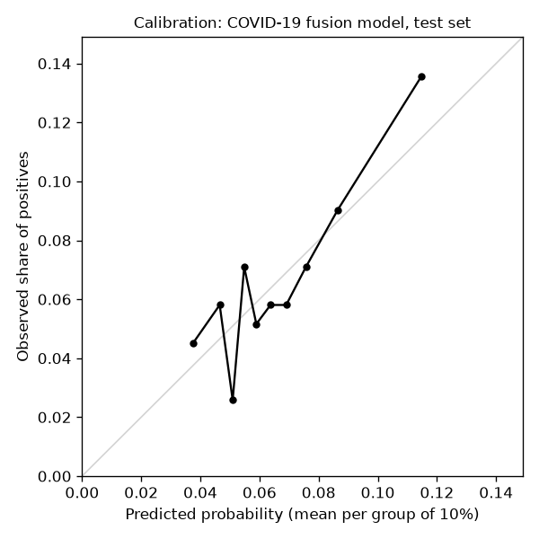

# COUGHVID: cough analysis from crowdsourced recordings

From a cough recording: (1) check that it really is a cough, (2) tell a wet from a dry cough, (3) estimate the risk
of COVID-19 and of respiratory symptoms, with the reasons behind each score. Every model is evaluated on recordings
it never saw, with confidence intervals, calibration and subgroup results, and the limits of what a cough can tell
are measured, not assumed.

**Not a medical device.** Investigational software developed with IEC 62304 Class B intent for the Indian market
(CDSCO); not licensed by CDSCO or cleared by any other regulator.

**Intended use (production):** detects whether a recording contains coughs; optionally estimates wet vs dry cough
type for clinician review. Does not diagnose COVID-19 or any other disease. The COVID-19 and respiratory-symptom
models below are research results only: in production they are not computed or shown (see why in
[docs/regulatory/05](docs/regulatory/05_risk_management_file.md)).

Regulatory documentation (intended use, development plan, requirements, architecture, risk file, SOUP list, test
protocol, traceability, audit and data protection, legal / DPDP, release and change control):
[docs/regulatory/](docs/regulatory/00_index.md).

Data: [COUGHVID v3](https://zenodo.org/records/7024894) (Orlandic, Teijeiro, Atienza, EPFL; CC BY 4.0), 34,434
recordings collected through a web app from April 2020 to October 2021, with self-reported status, symptoms, age and
gender, and labels from four pulmonologists for 2,890 recordings.

| Code | What it does |
|---|---|
| `cough/audio.py` | decoding (ffmpeg), cough segmentation (energy hysteresis), SNR |
| `cough/features.py` | ~95 handcrafted cough features and log-mel spectrograms |
| `cough/data.py` | metadata, expert majority vote, labels, pseudo-user groups, split, EDA |
| `cough/prepare.py` | step 1: decode every recording once and cache features (resumable) |
| `cough/panns.py`, `cough/embed.py` | step 2: PANNs CNN14 embeddings (pretrained on AudioSet) |
| `cough/cnn.py` | multi-task CNN on log-mel spectrograms |
| `cough/train.py`, `cough/evaluate.py` | step 3: models, fusion, calibration, evaluation, analyses |
| `cough/samd.py` | intended use, production / research mode, output gating, quality gate, labelling, forbidden inputs |
| `cough/audit.py` | append-only, hash-chained audit trail of every request; verify / find / seal |
| `cough/phi.py` | personal data: hash + features only by default, audio retention and purge, erasure |
| `cough/formats.py` | input format check in front of the models: detects the real format, rejects non-audio |
| `cough/versioning.py` | model versions (semantic versioning), model cards, registry, rollback |
| `cough/api.py`, `cough/static/index.html` | FastAPI service and web interface (recorder: Opus, MP4 fallback) |
| `tests/` | end-to-end tests on synthetic data in the real file format, format matrix tests |

## 1. Data exploration

| | Recordings |
|---|---|
| All recordings | 34,434 |
| Cough detected with probability >= 0.8 (used, as the dataset authors recommend) | 18,544 |
| Unclear (0.2 - 0.8, not used) | 7,352 |
| No cough (<= 0.2; 3,000 sampled as negatives for the cough check) | 8,538 |

Self-reported status of the 18,544 coughs: 10,132 healthy, 2,683 symptomatic, **720 COVID-19 (6.6%)**, 5,009 not
given. Median age 35 (31% missing); 8,639 male, 4,834 female.

- **Strong imbalance.** Only 6.6% of the labelled coughs are COVID-19, so accuracy is meaningless; results are
  reported as ROC-AUC, PR-AUC (against the 6.6% base rate) and sensitivity at 90% specificity.
- **Symptoms differ by status.** Fever or muscle pain: 28% of COVID-19, 24% of symptomatic, 7% of healthy
  recordings. Respiratory condition: 34%, 28%, 12%. A symptom questionnaire is therefore a strong baseline.
- **Recording quality differs by status.** Among the coughs used for the COVID-19 task, median SNR is 19.9 dB for COVID-19 and 23.1 dB for healthy recordings. A model can learn "noisy recording" instead of "COVID cough"
  (checked in section 4).
- **The experts disagree.** On the 130 recordings labelled by two or more pulmonologists, the same diagnosis was
  given only 29% of the time (Cohen's kappa 0.11), the same cough type (wet/dry) 62% (kappa 0.28). The expert
  diagnosis is too noisy to be a target; the wet/dry majority vote is used as a secondary task, knowing that it
  limits the reachable accuracy.
- **Two label sets.** `status` is self-reported; `status_SSL` was re-estimated by the authors' semi-supervised model
  and is only available for some recordings (285 COVID-19).
- 735 of the 21,544 selected recordings (3.4%) had no cough segment above the energy threshold; 5 files were empty.

## 2. Approach

**Audio processing.** Each recording is decoded to 16 kHz mono and peak-normalised. Coughs are segmented with an
energy hysteresis (start when the short-time energy exceeds a high threshold, end below a low one, small gaps merged,
0.15 s padding), as in the dataset authors' preprocessing. Median: 2 coughs per recording.

**Tasks.**

| Task | Label | Recordings (positives) |
|---|---|---|
| cough | cough_detected >= 0.8 vs <= 0.2 | 21,544 (18,544) |
| wet | expert majority vote: wet vs dry | 2,050 (473) |
| symptomatic | COVID-19 or symptomatic vs healthy (self-reported) | 13,535 (3,403) |
| covid | COVID-19 vs healthy (self-reported), main task | 10,852 (720) |

**Models** (one set per task):

| Model | Input |
|---|---|
| handcrafted | LightGBM on ~95 features: number, length and timing of coughs, onset sharpness, tail length, spectral shape, band energies, MFCCs |
| panns | logistic regression on the 2048-d embedding of PANNs CNN14, a CNN pretrained on AudioSet (2M clips, 527 sound classes) |
| cnn | small CNN (4 conv blocks, 0.3M parameters) trained from scratch on 5 s log-mel spectrograms, all tasks at once, with SpecAugment |
| fusion | weighted sum of the standardised model scores, weights chosen on validation, then Platt scaling to a calibrated probability |

**Evaluation without leakage.**
- No user id exists, so recordings from the same place (about 1 km) on the same day are grouped (16,645 groups) and a
  group is never split between train, validation and test (72 / 14 / 14%, stratified by status).
- Validation chooses everything: early stopping, regularisation, fusion weights, calibration and the decision
  threshold (90% specificity). The test set is used once.
- 95% confidence intervals by bootstrap (1,000 resamples of the test set).

## 3. Results (test set)

### COVID-19 vs healthy (main task): 1,550 test recordings, 103 COVID-19 (6.7%)

| Model | ROC-AUC (95% CI) | PR-AUC | Sensitivity at 90% specificity | ECE |
|---|---|---|---|---|
| handcrafted (LightGBM) | 0.609 (0.55-0.67) | 0.107 | 26% | 0.013 |
| PANNs embedding | 0.565 (0.50-0.63) | 0.090 | 14% | 0.015 |
| CNN (log-mel) | 0.562 (0.50-0.62) | 0.088 | 17% | 0.010 |
| **fusion** | 0.600 (0.54-0.66) | 0.126 | 22% | 0.011 |
| self-reported symptoms only (age, gender, fever/muscle pain, respiratory condition) | 0.670 (0.61-0.73) | 0.160 | 28% | 0.015 |
| **audio + self-reported symptoms** | 0.696 (0.65-0.75) | 0.173 | 32% | 0.015 |
| handcrafted without recording-quality features | 0.594 (0.54-0.65) | 0.094 | 18% | 0.012 |

At the threshold chosen on validation for 90% specificity, the audio fusion flagged 10% of test
recordings and caught 20% of COVID-19 cases at 91% specificity.



### Respiratory symptoms (COVID-19 or symptomatic vs healthy): 1,933 test recordings, 486 positive

| Model | ROC-AUC (95% CI) | PR-AUC | Sensitivity at 90% specificity | ECE |
|---|---|---|---|---|
| handcrafted (LightGBM) | 0.608 (0.58-0.64) | 0.336 | 19% | 0.021 |
| PANNs embedding | 0.576 (0.55-0.61) | 0.321 | 19% | 0.035 |
| CNN (log-mel) | 0.595 (0.57-0.62) | 0.334 | 18% | 0.018 |
| **fusion** | 0.627 (0.60-0.66) | 0.368 | 23% | 0.023 |

### Wet vs dry cough (pulmonologists' majority vote): 309 test recordings, 58 wet

| Model | ROC-AUC (95% CI) | PR-AUC | Sensitivity at 90% specificity | ECE |
|---|---|---|---|---|
| handcrafted (LightGBM) | 0.570 (0.48-0.65) | 0.254 | 16% | 0.081 |
| PANNs embedding | 0.671 (0.59-0.74) | 0.330 | 31% | 0.043 |
| CNN (log-mel) | 0.645 (0.56-0.72) | 0.258 | 16% | 0.073 |
| **fusion** | 0.674 (0.59-0.75) | 0.319 | 24% | 0.075 |

### Cough vs no cough: 3,078 test recordings

| Model | ROC-AUC (95% CI) | PR-AUC | Sensitivity at 90% specificity | ECE |
|---|---|---|---|---|
| handcrafted (LightGBM) | 0.988 (0.98-0.99) | 0.998 | 98% | 0.003 |
| PANNs embedding | 0.971 (0.96-0.98) | 0.991 | 94% | 0.015 |
| CNN (log-mel) | 0.979 (0.97-0.98) | 0.996 | 95% | 0.005 |
| **fusion** | 0.988 (0.98-0.99) | 0.998 | 98% | 0.003 |
| AudioSet "Cough" class of PANNs, no training | 0.906 | 0.977 | 68% | 0.475 |

### COVID-19 robustness checks (audio fusion unless stated)

| Check | ROC-AUC |
|---|---|
| gender: female (502 recordings, 43 COVID-19) | 0.590 |
| gender: male (1037 recordings, 58 COVID-19) | 0.620 |
| age: 30-50 (675 recordings, 39 COVID-19) | 0.654 |
| age: 50+ (257 recordings, 17 COVID-19) | 0.527 |
| age: <30 (540 recordings, 34 COVID-19) | 0.561 |
| age: not given (78 recordings, 13 COVID-19) | 0.633 |
| snr: >20 dB (909 recordings, 51 COVID-19) | 0.597 |
| snr: 10-20 dB (529 recordings, 40 COVID-19) | 0.557 |
| snr: <10 dB (112 recordings, 12 COVID-19) | 0.685 |
| coughs_in_recording: 2+ (1055 recordings, 81 COVID-19) | 0.616 |
| coughs_in_recording: 0-1 (495 recordings, 22 COVID-19) | 0.524 |
| cough_detected: >=0.95 (1089 recordings, 62 COVID-19) | 0.607 |
| cough_detected: 0.80-0.95 (461 recordings, 41 COVID-19) | 0.580 |
| time-based: handcrafted model trained before 2020-11-27, tested after (2,171 recordings) | 0.559 |
| SNR alone (lower SNR = higher score) | 0.563 |

| Labels used for training -> labels used for testing (handcrafted model) | ROC-AUC |
|---|---|
| self-reported -> self-reported | 0.609 |
| SSL -> self-reported | 0.532 |
| self-reported -> SSL | 0.597 |
| SSL -> SSL | 0.774 |


## 4. What the results show

1. **The cough check works.** ROC-AUC 0.988; recordings without a cough are rejected
   before any other score is shown. The pretrained AudioSet "Cough" class alone, without any training on COUGHVID,
   reaches 0.906, an independent confirmation of the dataset's cough labels.
2. **The cough carries only a weak COVID-19 signal.** Audio alone: ROC-AUC 0.600 (0.54-0.66), PR-AUC 0.126
   against a base rate of 0.067. Four self-reported answers (age, gender, fever/muscle pain,
   respiratory condition) do better: 0.670 (0.61-0.73). Adding the audio to them gives
   0.696 (0.65-0.75), a small gain. For COVID-19 the audio fusion (0.600) is not better than the handcrafted model alone (0.609);
   the difference is within the noise of 103 positive test cases. This agrees with the largest study on the question
   ([Coppock et al., 2024, Nature Machine Intelligence](https://arxiv.org/abs/2212.08570), UK COVID-19 Vocal Audio
   Dataset with PCR results): audio classifiers did not
   beat a simple symptom checker once confounders were controlled. The API therefore reports a risk score with its
   measured reliability, never a diagnosis.
3. **Part of the signal is the recording, not the cough.** COVID-19 recordings are noisier (median SNR
   19.9 dB vs 23.1 dB for healthy); SNR is the most important feature of the handcrafted model
   and SNR alone reaches ROC-AUC 0.563. Without SNR, loudness and length the handcrafted
   model drops from 0.609 to 0.594: most of its weak signal comes from the
   cough itself, but a deployed model would have to be checked on other devices and settings.
4. **It does not hold up over time.** Trained on recordings until 2020-11-27 and tested on
   later ones: 0.559. Variants, symptoms and the people using the app changed; a real
   system would need regular retraining and monitoring.
5. **More coughs and clearer coughs help.** Recordings with 2+ coughs: 0.616
   vs 0.524 with 0-1; cough_detected >= 0.95:
   0.607 vs 0.580. The API asks
   the user for 2-3 coughs in a quiet place.
6. **Wet vs dry is learnable but capped by the experts.** Best single model: the PANNs embedding, 0.671 (0.59-0.74); fusion
   0.674 (0.59-0.75). The experts themselves agree on cough type only 62% of the time (kappa 0.28), and the test set
   has only 58 wet coughs, hence the wide interval.
7. **Pretrained vs from scratch.** The PANNs embedding is the best single model for wet/dry (sound texture), the
   handcrafted features for COVID-19 and symptoms (timing, energy and spectral statistics). The CNN trained from
   scratch on 15k recordings is the weakest model alone for COVID-19 (0.562); the validation-tuned fusion still gives it
   weight for COVID-19, symptoms and wet/dry, and for symptoms the fusion is clearly better than any single model
   (better than the handcrafted model in 96% of bootstrap resamples).
8. **The SSL labels are not a fairer target.** Training and testing on the SSL labels gives
   0.774, but those labels were produced by the dataset authors' semi-supervised model
   trained on cough audio features, so they are easier to predict from audio by construction; on the self-reported labels the SSL-trained model reaches
   only 0.532. All headline results use the self-reported labels.
9. **Calibration.** Probabilities are calibrated on validation (ECE 0.011 on test for COVID-19), so a
   predicted 10% means about 10% of such recordings were COVID-19 positive in this dataset.



## 5. Run (Windows PowerShell)

```powershell
cd coughvid
pip install -r requirements.txt
python -m pytest                                   # offline tests on synthetic data
python -m cough.prepare --raw data\raw             # decode + features (~26 min, resumable)
python -m cough.embed                              # PANNs embeddings (~90 min on CPU, resumable)
python -m cough.train --bump minor --notes "..."   # models + evaluation (~95 min on CPU) -> new model version
python -m uvicorn cough.api:app --port 8008        # production mode: http://localhost:8008, API docs: /docs
$env:COUGH_MODE="research"; python -m uvicorn cough.api:app --port 8008   # research mode: all outputs, test set
python -m cough.audit --verify                     # check the audit trail
python -m cough.phi --purge                        # delete audio past its retention (daily)
python scripts/soup_versions.py                    # exact SOUP versions -> docs + requirements.lock.txt
```

- Data: unzip `public_dataset_v3.zip` ([Zenodo](https://zenodo.org/records/7024894) or the same files on
  [Kaggle](https://www.kaggle.com/datasets/orvile/coughvid-v3)) into `data\raw`.
- PANNs checkpoint: `Cnn14_mAP=0.431.pth` from [Zenodo record 3987831](https://zenodo.org/record/3987831) into
  `models\`.
- ffmpeg is taken from the PATH or from the `imageio-ffmpeg` package (no separate install).
- `python -m cough.train --cnn resume` continues CNN training from the current version's `cnn.pt`; `--cnn reuse`
  skips it. Progress is written to `train_log.txt` inside the new version folder.
- Test data in every format: `python scripts/make_synthetic.py --out data\synthetic_formats --n 60 --formats all`.

## 6. Interface and API

**Web interface** (http://localhost:8008): record a cough with the microphone (10 s; Opus where the browser supports
it, i.e. WebM/Opus in Chrome, Edge and Firefox, otherwise MP4/AAC, e.g. Safari and iPhone),
upload a file, or pick a test-set recording. It shows the waveform with the coughs found, the audio, the cough check,
wet/dry (for clinician review), in research mode also the COVID-19 and symptom risks with their thresholds, reliability and reasons, the true label for test-set
recordings, and the test-set performance of every model.


| Endpoint | Purpose |
|---|---|
| `POST /analyze` | upload a recording (webm, ogg, mp4, m4a, wav, mp3, aac, flac, 3gp, amr) |
| `GET /formats` | accepted formats |
| `GET /examples?status=COVID-19` | test-set recordings (never used in training) with their labels and scores |
| `GET /examples/{uuid}/analyze` | full analysis of a test-set recording, next to its true labels |
| `GET /examples/{uuid}/audio` | the audio file of a test-set recording |
| `GET /model-info` | model version card, EDA and all results |
| `GET /health` | status and model version |

### Input formats

Phones, browsers and regions record in different formats. Before a file reaches the models, `cough/formats.py`
checks it:

1. **Detect** the real format from the first bytes of the file (magic numbers), not from the file name or the
   Content-Type, which are often wrong: an MP3 renamed to `.webm` is still detected as MP3.
2. **Decide:** a supported audio format continues. Anything else (image, PDF, zip, text, unknown) gets
   `415 Unsupported Media Type` with the list of accepted formats. An empty file gets `400`, a file over 20 MB `413`,
   and a file that looks like audio but does not decode (truncated, corrupted) `422`.
3. **Convert** every format with ffmpeg to the one input the models were trained on: 16 kHz mono PCM, peak-normalised.

The response says what was received: `"input": {"format": "mp4", "codec": "aac", "extension_matches": true,
"converted_to": "16 kHz mono PCM"}`.

Format matrix tests (`tests/test_formats.py`): the synthetic generator writes the same cough recording in 10
formats (WebM/Opus, Ogg/Opus, Ogg/Vorbis, MP4/AAC, M4A/AAC, AAC, MP3, WAV 16-bit, WAV 8 kHz telephone quality,
FLAC). For every format, the tests check detection, decoding to the same model input (same length, the same
coughs found), and `POST /analyze` with the right file name, a wrong file name and no file name. Non-audio files,
empty, oversized and truncated files are checked to be rejected with the right status code.

### Model versions

Every training run creates a new version, named with semantic versioning:

| Part | When | Example |
|---|---|---|
| MAJOR | new architecture, new input features, or a change to the API output | 1.4.2 -> 2.0.0 |
| MINOR | retrained: new data or hyperparameters, same architecture | 1.4.2 -> 1.5.0 |
| PATCH | fix that does not change what the model learned (threshold, calibration, bug) | 1.4.2 -> 1.4.3 |

Name: `<project>_v<MAJOR.MINOR.PATCH>_<model type>_<YYYYMMDD>`, e.g. `artifacts\coughvid_v1.1.0_fusion_20261028\`.
Each version folder holds the models and a model card `version.json`: version, parent version, date, git commit,
data fingerprint, training arguments, notes, test ROC-AUC. `artifacts\registry.json` lists every version, and
`artifacts\LATEST` names the one the API serves.

```powershell
python -m cough.versioning --adopt-legacy            # existing flat artifacts\ -> coughvid_v1.0.0_fusion_<date>
python -m cough.train --bump minor --notes "retrained on ..."
python -m cough.versioning --list                    # all versions, * = served
python -m cough.versioning --use 1.0.0               # rollback: serve another version
```

The response contains: the cough segments found and the SNR; the cough check (model probability and the AudioSet
"Cough" probability); wet/dry; COVID-19 and respiratory-symptom probabilities with a flag at the 90%-specificity
threshold and how reliable that flag was on the test set; the three features that moved each score most (LightGBM
SHAP values); and the disclaimer. Recordings without a clear cough are rejected with a request to record again.

## 7. Limitations and next steps

- **Labels are self-reported** (no PCR result) and the population is self-selected web-app users; the COVID-19
  numbers describe this dataset, not clinical performance.
- **No user id**: grouping by place and day prevents most repeated submissions from leaking between splits, but not
  all.
- **CPU only**: the CNN is small and was trained for 20 epochs (12 + 8 continued, best validation epoch kept); a
  GPU would allow fine-tuning PANNs end to end or a health-acoustics model such as Google HeAR.
- **Next steps**: per-cough (segment-level) modelling with aggregation over the coughs of a recording; recording
  -condition normalisation (or matching COVID-19 and healthy recordings by SNR and device) to remove the shortcut;
  evaluation on the authors' private test set (available on request from EPFL) and on a PCR-labelled dataset such as
  the UK COVID-19 Vocal Audio Dataset.
